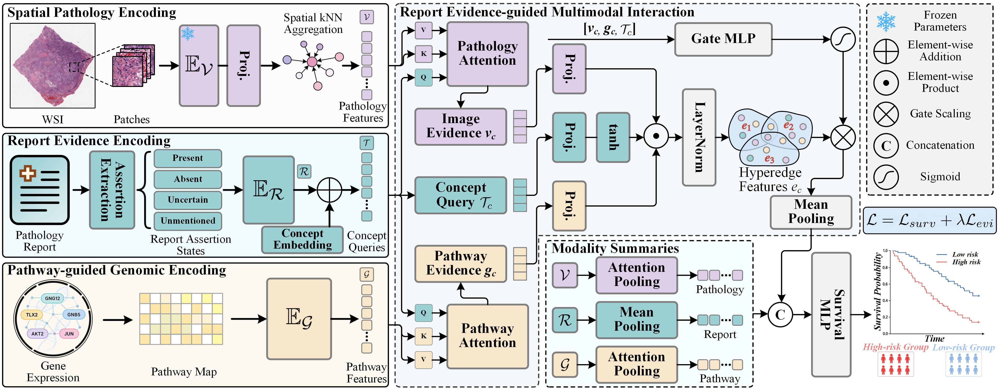

# REHSurv

Report Evidence-guided Hypergraph Network for Multimodal Survival Prediction.



This compact research release contains the proposed model, data adaptation,
training, and held-out evaluation only. It operates on precomputed pathology
features, processed pathology report text, and gene expression. It does not
include raw-slide processing, UNI2-h weights, OCR/LLM services, figures,
baselines, ablation runners, real patient data, or pretrained survival weights.

## Install

Python 3.10 or newer is required; Python 3.10–3.12 is recommended.
Install a PyTorch build suitable for your machine, then:

```bash
python -m pip install -r requirements.txt
```

Run the commands below from the repository root. CPU and CUDA are supported;
`--device auto` uses CUDA when available. There is no SSH dependency.

## Prepare your data

Provide these three inputs:

1. `patients.csv`: one row per patient, with columns
   `patient_id,cohort,fold,time,event,time_unit,feature_paths,report`.
   `fold` is an existing patient partition numbered 0–4. `event=1` means an
   observed event; `event=0` means right censoring. `time` must be nonnegative.
   Verify the endpoint and use one explicit unit (`days`, `months`, or `years`)
   per cohort. `report` is processed report text, or an empty string for missing
   evidence. The supplied rule extractor supports English report concepts.
   `feature_paths` is a JSON list of paths stored as a CSV cell, for example
   `["features/slide_a.h5", "features/slide_b.h5"]`; use a CSV writer to escape
   quotes correctly. Paths are relative to the CSV location or absolute.
   Each feature file is NPZ or HDF5 with `features` of shape `[patches,D]` and
   `coords` of shape `[patches,2]`. Include all slides for each patient.
2. `expression.npz`: arrays `patient_ids[N]`, `genes[G]`, `values[N,G]`.
   IDs and genes must be Unicode string arrays, not Python object arrays.
   Values are the finite, consistently preprocessed expression measurements
   before cohort-wide z-scoring. Optional Boolean `measured[G]` marks genes
   measured for the whole archive. Patient-specific missing measurements are
   not supported. No train/test normalization should be applied beforehand.
3. `pathways.json`: an ordered mapping from pathway names to gene lists,
   e.g. `{"pathway_a":["GENE1","GENE2"],"pathway_b":["GENE2","GENE3"]}`.
   Gene identifiers must match `genes`. Supply the appropriate KEGG gene sets
   separately; pathway resources are not bundled or downloaded automatically.

```bash
python prepare_data.py --manifest /path/patients.csv --expression /path/expression.npz --pathways /path/pathways.json --output data/prepared --feature-dim 1536
```

The adapter preserves your folds, extracts the 12 report concepts, checks
feature dimensions, IDs, units and slide ownership, and writes
`patients.jsonl`, `expression.npz`, and `provenance.json`. It does not copy
feature files. They must remain accessible. Empty pathways are masked.
Missing or unmentioned reports are distinct from explicit negative assertions.
Use an empty output directory. Existing compatible prepared caches can also
be used directly; relocate their feature paths if needed.

## Train and test

The entry point is the user-supplied latest `main.py`. Edit its `DEFAULTS`
or use CLI overrides. It runs directly on the current machine on Windows
or Linux, without SSH. Model/training hyperparameters remain those of the
latest source. `--print_config` prints the resolved settings. No remote execution options,
SSH configuration, connection code, or server launcher is included.

```bash
python main.py --print_config
python main.py --data-dir data/prepared --cohort LUAD --output-dir runs --device auto
python main.py --data-dir data/prepared --cohort LUAD --fold_list 0 --device cpu
python main.py --test_only --checkpoint runs/RUN_NAME/fold_0/best.pt --data-dir data/prepared --output-dir runs/retest --device auto
```

The four manuscript cohorts are LUAD, BLCA, BRCA, UCEC. Use `--data-dir`
for a custom location. All five folds run by default. `--gpu 0` selects the
physical GPU when CUDA is used. No remote launcher is included.
The formal trimodal entry requires nonempty report text for every patient.
The data adapter adds the required `has_report` field.

For rotation k, test=k, validation=(k+1)%5, and the remaining three folds
train the model. All slides remain with their patient. Expression scaling
and survival cutpoints are fitted on training patients only. Validation
C-index selects the checkpoint, controls early stopping and LR scheduling.

Defaults: 1536 input features, hidden dimension 128, spatial k=8, 12 report
concepts, all patches, top 12 pathways, dropout=0.1, gate temperature=0.67,
KL weight=0.02, report dropout=0.15, AdamW lr=2e-4, weight decay=1e-4,
batch size=1, at most 40 epochs, patience=10, seed=42, 16 test gate samples.
Supply the manuscript's 186 KEGG pathways and UNI2-h features separately.
The adapter can accept alternative feature/pathway inputs, but those are
changed input settings, not the manuscript experiment.

The latest main.py also sets requested survival bins=8, LR plateau patience=3,
minimum improvement=0.001, gradient clipping=5. These implementation details
are retained from that file; their numerical values are not all reported in
the manuscript. They are not claimed to have been specified by the paper.
Duplicate training event quantiles reduce the effective number of bins.

Runs contain fold_0 through fold_4, each with best.pt, config, split, history,
metrics and predictions. The experiment summary includes C-index, mean
supported-time AUC and IBS, with sample standard deviations over folds.
Checkpoints include scalers, cutpoints, vocabularies and original partitions.
Independent testing reuses this preprocessing and the original test patients;
it does not fit scalers again. Keep checkpoints private because they contain
patient metadata. For relocated data, the manifest and expression archive
must be unchanged and the feature paths must remain accessible.

Metrics include C-index, IPCW time-dependent AUC and IBS at finite training
cutpoints. Unsupported horizons return null with an explanation. Fold summary
statistics exclude undefined values and report valid-fold counts; standard
deviation uses ddof=1. AUC values are available per horizon in each metrics
file. Predictions include survival curves, risks, and stochastic gate
variability. The variability is not a calibrated clinical confidence interval.

## Release notes

The local main.py entry implements disjoint patient partitions, complete
checkpoints, and validation C-index model selection. Regression fixes cover
coordinated negation, validation comparability, feature suffix handling, and
checkpoint data-path reuse. See SOURCE_NOTES.md for implementation notes.
Only the main architecture is exposed; no plot/ablation/baseline scripts or
real patient data are included. Synthetic end-to-end checks are performed;
real-cohort manuscript metrics have not been reproduced during packaging.

The package contains no dataset or gene-set license grant. The author should
choose a code license before public distribution and cite the manuscript and
the feature/data/pathway resources used. No code license is assumed here.

## 中文快速说明

此仓库仅保留主模型、必要的数据适配、训练与测试，不含绘图、消融、基线或服务器脚本。
先按上面的字段准备患者 CSV、表达 NPZ、通路 JSON，再运行 `prepare_data.py`。
默认使用全部 patch；输入是已提取的特征，不是原始 WSI。
报告输入为已处理的英文文本，规则抽取在本地完成，不调用外部模型。
训练运行 `main.py`；对保存模型单独测试运行 `main.py --test_only`。
`--cohort` 必须与 CSV 的 cohort 字段一致，特征维度改变时在适配和训练（`--input_dim`）两处同步修改。
所有折必须有足够患者与事件以支持训练和验证；程序不重新划分患者。
公开上传时仅上传本仓库代码，真实数据和训练输出应留在私有目录。

## Regression fixes

Coordinated leading negation is carried across bare list items and stops at
contrastive connectors or a new explicit assertion. Validation folds without
comparable survival pairs fail before training (no fallback selection metric).
Feature suffix matching is case insensitive. During --test_only, an omitted
--data-dir uses the checkpoint location; an explicit CLI or JSON data_dir
overrides it. Prepared report caches created before the negation fix must be
regenerated and models retrained to use the corrected assertions. The English
rule extractor is heuristic and does not guarantee arbitrary clinical syntax.

Run regression checks: `python -m unittest discover -s tests -v`.
